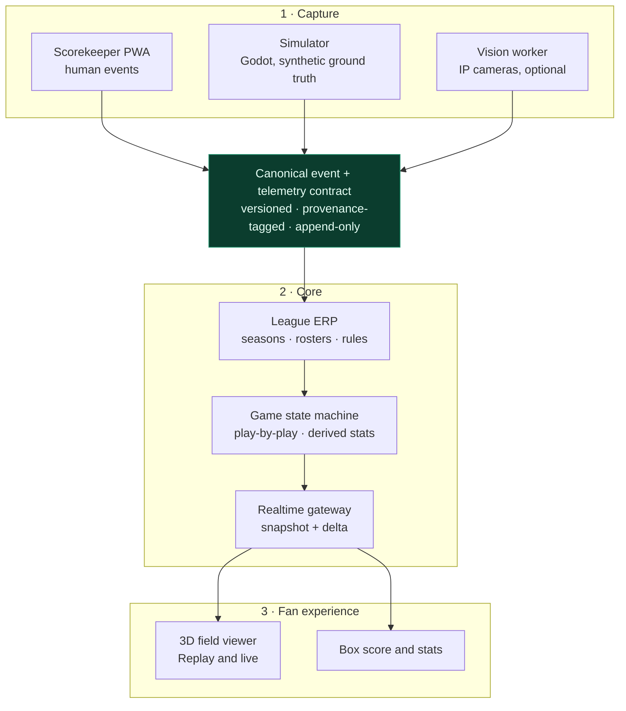

# Open League Baseball

**Open-source scorekeeping, league management and game-day visualization for leagues that don't have a Hawk-Eye budget.**

> **Status: pre-alpha.** This repository holds design documents only. There is no runnable code yet, no release, and no pilot league. Everything below is a stated intention, not a delivered feature — see the [roadmap](#roadmap).

---

## The gap

Professional baseball measures everything. Every pitch gets a release point, a spin rate, a plate location, a 3D trajectory rendered live in the browser within a second. That stack — camera arrays, radar, proprietary calibration, per-game licensing — is priced for organisations with broadcast revenue.

Below that tier, the state of the art is often a paper scorebook and a spreadsheet typed up the following week. The data exists, but it dies in a notebook.

Two things are missing between those worlds:

1. **Software that treats a human scorekeeper as a first-class data source**, not as a fallback.
2. **A live visualization layer that degrades gracefully** — running on a laptop with no cameras, improving as hardware arrives, never requiring a rewrite.

Open League Baseball is an attempt at both.

## The approach

Three decoupled layers, joined by a versioned event contract rather than by assumptions about each other.



The contract in the middle is the project. Layers can be replaced — a different scorer UI, a better tracker, a different renderer — as long as they speak it. That is why the [data contract](docs/vision.md#5-the-canonical-data-contract) is the first thing specified and the only thing treated as a compatibility surface.

**Scorekeeping first.** The product is useful with zero cameras and zero machine learning. Vision is an accelerator bolted onto a working system, never a precondition for one.

## Repositories

The project is a set of independent repositories joined by a published contract, not a monorepo ([ADR 0002](docs/adr/0002-repository-topology.md)). Each one can be built, versioned and deployed on its own.

| Repository | Responsibility | Stack |
| --- | --- | --- |
| [`olb`](https://github.com/beny0102/olb) | Whitepaper, ADRs, compose profiles, acceptance suite | Docs, Docker |
| [`olb-contract`](https://github.com/beny0102/olb-contract) | Canonical schema, codegen, conformance fixtures | JSON Schema → TS + Python |
| `olb-api` | League ERP, game state machine, realtime gateway | NestJS, Postgres, Redis |
| `olb-web` | Public viewer and league pages | Next.js, React Three Fiber |
| `olb-scorer` | Scorekeeper PWA, offline-first | Next.js, IndexedDB |
| `olb-vision` | Calibration CLI and pitch tracking | Python, OpenCV, YOLO |
| `olb-sim` | Synthetic games with ground truth | Godot 4 headless |

`olb` and `olb-contract` (v0.1.0) exist today. The rest are created as Phase 0 work; links go live as each repository is published.

## What works without cameras

| Capability | `basic` | `demo` | `vision` |
| --- | :---: | :---: | :---: |
| Seasons, teams, rosters, eligibility | ✅ | ✅ | ✅ |
| Live play-by-play from a phone | ✅ | ✅ | ✅ |
| Box score, standings, season stats | ✅ | ✅ | ✅ |
| 3D field with animated plays | — | ✅ | ✅ |
| Pitch location, speed, break | — | seeded | measured |
| Multi-camera 3D trajectory | — | seeded | planned |

`demo` is the portfolio path: a seeded league with a pre-recorded game looping in the viewer, so anyone can evaluate the project with one command and no data entry.

## What this is not

Scope discipline is part of the design. These are *non-goals*, not backlog items:

- **No player tracking in v1.** Vision is scoped to the pitch: release point, plate location, speed, break. Full 18-player tracking and batted-ball 3D are research ambitions, described as such.
- **No native mobile apps.** The scorer is a PWA; the viewer is responsive web.
- **No betting, odds, or wagering integrations.** Ever.
- **No facial recognition**, and no identity inference from video.
- **No redistribution of MLB or other licensed data.** The play-by-play model is inspired by [Retrosheet](https://www.retrosheet.org/) conventions, which are freely published.
- **No video editing suite.** Clips and highlights are out of scope until the core is stable.
- **No "AI-powered" catch-all features.** Every model must name the decision it makes and the error it can produce.

## Deployment profiles

One compose file, four profiles. The point of the DIY story is that a league starts on profile `basic` and never has to migrate away from it.

```bash
docker compose --profile basic up -d    # API, Postgres, web. Laptop-class.
docker compose --profile demo  up -d    # basic + seeded league + looping game
docker compose --profile vision up -d   # + GPU vision worker + camera ingest
docker compose --profile sim   up -d    # + Godot headless simulator
```

*Planned. Profiles are specified in [docs/vision.md](docs/vision.md#11-deployment-and-hardware); none of these commands work yet.*

## Roadmap

| Phase | Deliverable | Exit criterion |
| --- | --- | --- |
| **0 · Foundations** | Data contract v1, repository topology, compose profiles, CI, ADRs | Contract compiles to TypeScript and Python from one source; CI green |
| **1 · Scorekeeping** | League ERP, scorer PWA (offline-first), game state machine, live gateway, 2.5D viewer | A seeded 9-inning game is scored end to end and followed live on a phone |
| **2 · Simulation and 3D** | Godot headless simulator with ground truth, R3F 3D viewer, replay | A synthetic game renders with true 3D trajectories, reproducible from a seed |
| **3 · Pitch vision** | Calibration CLI, single/dual camera pitch tracking | Plate location within a stated tolerance on a physical field |
| **4 · Multi-camera** | Time sync, triangulation, batted-ball flight, player tracking | Research phase; no date committed |

Each phase must leave the previous one working. There is no "big rewrite" slot in this plan.

## Reference hardware

| Profile | Spec | Approx. cost |
| --- | --- | --- |
| Annotator only | Any laptop, 2 vCPU / 2 GB RAM | €0 |
| Self-hosted core | Mini-PC, 4 vCPU / 8 GB RAM / 256 GB SSD | €250–400 |
| Vision build | Mini-PC + NVIDIA RTX 3060 12 GB, 2× PoE cameras (global shutter, 1080p60), switch, UPS | €1,400–1,800 |
| Development (this project) | Ryzen 3 3300X, 46 GB RAM, Radeon RX 5700 XT 8 GB on ROCm | — |

Notes that belong in a README rather than a footnote:

- **NVIDIA is the supported path** for the vision worker. AMD works — the machine above runs PyTorch on ROCm — but RDNA1 (`gfx1010`) is outside ROCm's officially supported list, so versions are pinned and breakage is expected on upgrades.
- 8 GB of VRAM handles **one** 1080p stream comfortably, not four. The hardware page in the docs states the actual limits instead of implying headroom.
- Video is the dominant storage cost: roughly 40–60 GB per game for two 1080p60 streams. This drives the retention defaults in the privacy section.

## Privacy

The target audience includes youth leagues, which means the default configuration must be safe for children's data.

- Public viewer defaults to **jersey number and position**, not name or likeness.
- Name publication is an explicit, revocable opt-in per player.
- Video retention defaults to **7 days**, configurable, with a documented deletion path.
- No facial recognition, no biometric templates, no identity inference.
- Consent records are part of the data model, not a policy document.

See [docs/vision.md §10](docs/vision.md#10-privacy-and-minors).

## Contributing

Design-only phase, so the most useful contribution right now is **review of the data contract**: attack the schema, not the code.

- License: [Apache-2.0](LICENSE), no open-core, no CLA.
- Sign-off required ([DCO](https://developercertificate.org/)), not a contributor agreement.
- Conventional Commits; ADRs for decisions that are hard to reverse.
- Documentation and code in English; the product UI ships in Spanish first, with i18n from day one.

## Acknowledgements

The event model borrows heavily from [Retrosheet](https://www.retrosheet.org/)'s public event file conventions — a decades-long act of volunteer archival work that this project would rather build on than reinvent. MLB Gameday is the reference for what a fan-facing live view should feel like; it is a comparison, not an affiliation.
