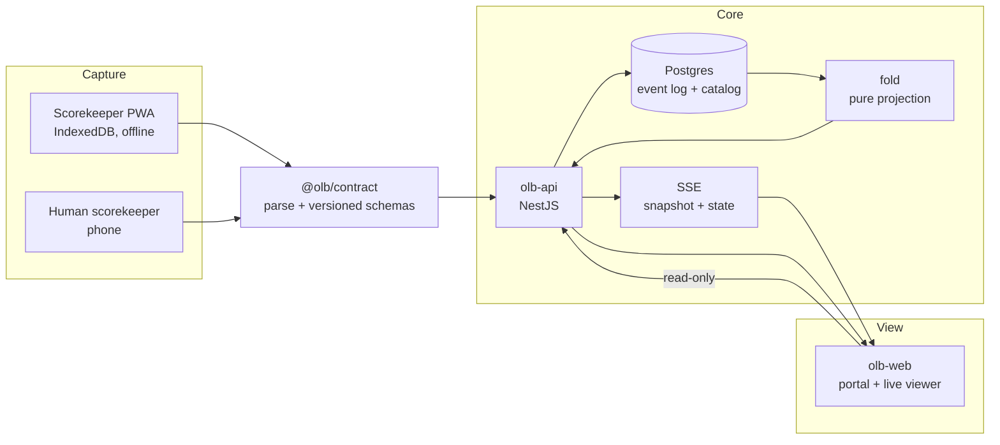

# Case study: D4, a deployable OLB slice

**Status:** implemented and verified locally · 2026-11-05
**Scope:** the D4 deployment package. No new product features, no public URL
change, no tailnet change.

This document records what was built, how it was verified, and what it still
does not do. It is a snapshot of one working slice, not a claim that Open League
Baseball is production-ready.

## 1. The problem

A volunteer league has a paper or spreadsheet scorebook, a phone recording and
no structured data. The game happens once; the record is reconstructed by hand
afterwards and dies in a notebook.

OLB targets the tier below professional tracking systems with three rules:

- a human scorekeeper is a first-class data source, not a fallback;
- every layer speaks one versioned event contract, so capture, core and viewer
  can be replaced independently;
- the minimum deployment is useful with no cameras, and the same stack accepts
  measured telemetry later without a rewrite.

D4 closes the loop from "the code works on a developer machine" to "a league
operator can start the stack, seed a league, score a game and take a backup".

## 2. Architecture



- **Contract.** `@olb/contract` is the compatibility surface. The API parses
  every event at the boundary; unknown fields survive and unknown event types
  are ignored.
- **API and event log.** `olb-api` owns games, events, proposals and the league
  catalog. The log is append-only; `/state`, `/boxscore` and `/standings` are
  folds, never stored copies.
- **Postgres.** One database holds the event log, the league catalog, game
  summaries, auth sessions and memberships. Migrations are versioned and
  append-only; the API applies pending migrations on startup.
- **Web.** `olb-web` is the public portal and game viewer. Server components
  read the API over the compose network; the browser polls the published API
  origin. The portal exposes only domains the API actually returns.
- **Scorer.** `olb-scorer` is an offline-first PWA. A game is scored into a
  local IndexedDB log with or without connectivity; sync is idempotent by event
  `id`, not by queue position.
- **SSE.** `GET /games/:id/stream` sends an initial `snapshot` and then a
  `state` message after each append. The web viewer also polls, so a dropped
  stream degrades to a slower view instead of a broken one.

## 3. Product model

```text
organization
  └── season (one active per organization)
        └── competition (league or division)
              └── team season
                    └── roster entry → player
                          └── game
```

- **Organization** is the tenant boundary. Seasons belong to an organization;
  creating a new active season archives the previous one.
- **Competition** is a league or a division. A season can publish more than one
  table, and a competition can nest under a parent.
- **Team season** binds a club to a season and a competition. Rosters are
  eligibility windows, not a flat list of names.
- **Game coverage** is explicit:
  - `full`: play-by-play exists in the event log; state, box score and player
    leaders can be derived.
  - `summary`: only a final score and optional linescore/team box exist.
  - `external`: an imported summary; it counts in standings but has no
    play-by-play.
- **Scopes** follow the model, not a global role:
  - `org_admin` manages the organization's catalog;
  - `competition_admin` manages a competition and its teams/games;
  - `team_admin` and `scorer` manage one team season;
  - `verifier` can review proposals without writing game data.

Reads are public. Admin writes require a Bearer token and a membership that
covers the target row.

## 4. Key decisions

| Decision | Why |
| --- | --- |
| Append-only log with `revisionOf` and `amendment` | A correction is a new event. History explains what happened, including mistakes, and every consumer folds the same way. |
| Client-supplied UUIDv7 event ids | Retries are idempotent without a server-side dedupe table. Reusing an id in another game answers `409`. |
| One active season per organization | The portal and default queries have an unambiguous "current" season. Archived seasons stay readable. |
| Explicit `full` / `summary` / `external` coverage | A score with no play-by-play is useful, but it must not silently produce player stats or invented lines. |
| Membership scopes, server-generated catalog ids | Authorization follows the domain hierarchy; a client cannot choose or reuse an admin id. |
| Postgres row lock per game when appending | Two API writers cannot assign the same `seq`. |
| SSE snapshot first, then deltas | A client that connects late still gets a complete state before updates. |
| No invented play-by-play or player box | Leaders come only from full games; unsupported fields such as ERA are omitted, not estimated. |

## 5. Verification

All commands were run on 2026-11-05 in the `~/work/olb` workspace.

| Surface | Command | Result |
| --- | --- | --- |
| Contract, TypeScript | `cd olb-contract && npm test` | 19 passed, 0 failed |
| Contract, Python | `.venv/bin/python -m pytest -q` | 20 passed |
| API | `cd olb-api && npm test` | 122 passed, 3 skipped (Postgres integration) |
| Web | `cd olb-web && npm test` | 56 passed |
| Scorer | `cd olb-scorer && npm test` | 153 passed |
| Compose build | `docker compose -f deploy/docker-compose.yml up -d --build` | 4 services healthy |
| Seed | `seed-league` then `seed-demo` | 1 organization, 1 season, 2 competitions, 4 teams, 72 roster entries, 8 catalog games; demo game 5–3 with 206 events |
| Portal | `HTTP 200 http://localhost:3200/` | league name and seeded teams rendered |
| Stats | `HTTP 200 http://localhost:3200/stats` | standings and leaders page rendered |
| Scorer | `HTTP 200 http://localhost:3202/` | scorer shell rendered |
| Login | `POST /auth/login` as `admin@liga-metropolitana.olb` | token issued; `/auth/me` returned 1 membership |
| Stats API | `GET /seasons/:id/stats` | 2 competition groups; player leaders empty until a full game is attached to the catalog |
| Backup, live manual DB | `BACKUP_CONTAINER=olb-postgres ./deploy/backup.sh` | 44 KB custom-format dump |
| Restore, live manual DB | `RESTORE_CONTAINER=olb-postgres ./deploy/restore.sh <dump> --db olb_restore_test` | 15 public tables restored |
| Parity | counts + sample game before/after restore | 1 organization, 1 season, 4 teams, 72 players, 10 games, 208 events, 4 users, 5 memberships; game `0192f3a2-0100-7000-8000-000000000001`, `seq 207`; event counts match |
| Guard | restore into `olb` without `--force` | exit 1, refused |
| Compose backup/restore | `./deploy/backup.sh` then `restore.sh --db olb_restore_compose` | table counts match the compose database |
| Teardown | `docker compose -f deploy/docker-compose.yml down -v` | no deploy containers, network or volume left; manual `olb-postgres` untouched |

Screenshots from the same build cycle are in the workspace under
`artifacts/d1b1/` and `artifacts/d1b1-live/` at 1280 and 390 px. They are
workspace artifacts, not files in this repository.

The verification is honest about its limits: the API's Postgres smoke and
migration tests are skipped in the default test run because they need an
explicit integration database. The restore drill above is the check that
actually exercised Postgres.

## 6. Operations

The package lives in `olb-api/deploy/` so the compose file travels with the
service that owns the database.

```bash
cp deploy/.env.example deploy/.env
docker compose -f deploy/docker-compose.yml up -d --build

docker compose -f deploy/docker-compose.yml run --rm api \
  node dist/scripts/seed-league.js

docker compose -f deploy/docker-compose.yml run --rm \
  -e API_URL=http://api:3001 api node dist/scripts/seed-demo.js
```

Ports are deliberately not the manual deployment's ports:

| Service | Host | Container |
| --- | ---: | ---: |
| Web | 3200 | 3000 |
| API | 3201 | 3001 |
| Scorer | 3202 | 3002 |
| Postgres | 55451 | 5432 |

All host bindings are localhost. The compose volume is project-scoped
(`olb-deploy_olb-pgdata`), so `down -v` cannot delete the manual
`olb-pgdata` volume used by `olb-postgres`.

### Migrations

Migrations run when the API starts and can be run alone:

```bash
docker compose -f deploy/docker-compose.yml run --rm api node dist/scripts/migrate.js
```

They are append-only. A shipped migration is never edited; schema changes add a
new version.

### Backup and restore

```bash
./deploy/backup.sh
RETENTION_DAYS=14 ./deploy/backup.sh
BACKUP_CONTAINER=olb-postgres ./deploy/backup.sh
```

`backup.sh` writes `deploy/backups/olb-YYYYmmdd-HHMMSS.dump` with
`pg_dump -Fc`, prunes by file age (default 7 days) and does not commit the
directory. A cron entry or a systemd timer runs it nightly. Copy the dumps
off-host; a backup on the same disk is not a backup.

`restore.sh` requires `RESTORE_DB` (or `--db`) and refuses to overwrite the
live `olb` database unless `--force` is passed. Restore into a scratch
database, compare the table counts and one game state, then drop it. A backup
that has not been restored is unverified.

## 7. Known limits

- **Single-instance SSE.** The event stream is in-process. Two API replicas
  would not fan out to each other without Redis pub/sub or Postgres
  `LISTEN/NOTIFY`. The deploy package runs one API replica.
- **No admin UI.** Catalog writes exist as scoped API endpoints; operators use
  `curl` or the API, not a web form.
- **No webhooks.** There is no outbound event subscription, no integration
  with a league website and no notification channel.
- **No player box beyond leaders.** The box score is team-level runs, hits,
  errors and linescore. Batting and pitching leaders are season aggregates from
  full games; there is no per-player game box score and no fielding statistics.
- **No multi-instance realtime and no queue.** The scorer syncs idempotently but
  the stack does not include a message broker.
- **Demo identities are not production identities.** The seed creates known
  passwords for local evaluation; replace them before any non-local use.
- **Vision and simulation remain reserved.** The `vision` and `sim` profiles
  are documented intention, not part of this slice.
- **No public deployment change.** The existing manual deployment and tailnet
  configuration were left as they were. D4 adds a package, it does not replace
  the running site.

## 8. What the slice proves

A league can start the stack with one command, seed a reproducible catalog, open
a public portal and scorer, authenticate an operator, take a logical backup and
restore it into a scratch database with matching counts. That is the smallest
operational story worth calling deployable.

It does not prove scale, high availability, public security hardening or
production backup retention. Those are the next questions, not hidden
assumptions.
