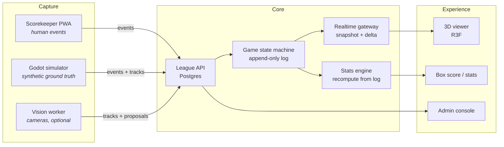

# Open League Baseball — Technical Vision

**Document status:** draft v0.1 · 2026-10-31
**Scope:** architecture, data contract, and delivery plan. No implementation yet.
**Audience:** contributors, reviewers, and anyone evaluating whether this project is technically serious.

---

## 1. Purpose and audience

Open League Baseball (OLB) is an open-source platform for baseball leagues that operate below the analytics budget of professional baseball: amateur, youth, university, and mid-tier semi-professional leagues.

It combines three things that are usually sold separately and priced accordingly:

1. A **league ERP**: seasons, teams, rosters, eligibility, schedules, digital game records.
2. A **hybrid scorekeeping and computer-vision pipeline** that produces play-by-play plus spatial telemetry.
3. A **live 3D game-day viewer** in the browser, in the spirit of MLB Gameday.

The project is currently a **portfolio-grade design exercise**, not a product with users. There is no pilot league. This document is written so that a skeptical reader can tell what is specified, what is guessed, and what is not started.

## 2. The problem

### 2.1 What exists today

At the top of the market, a professional ballpark measures the ball and every player continuously: multi-camera arrays, radar, sub-centimetre calibration, and a broadcast-grade visualization layer. The cost structure assumes media rights.

Below that line, most leagues have:

- a paper or spreadsheet scorebook, entered by a volunteer,
- a phone camera recording the game for the archive,
- no structured spatial data at all,
- statistics that are recomputed by hand, inconsistently, at the end of the season.

### 2.2 Why the obvious solutions fail

| Approach | Why it fails at this tier |
| --- | --- |
| Buy a commercial tracking system | Capital plus per-game fees; requires fixed installation and trained operators |
| Use a stat-tracking app only | Produces numbers, not a game-day experience; usually closed data |
| Stream the game on video | No structure. A recording is not data; nobody can query it |
| Build a custom system per league | Each league reinvents the scorebook, badly, and the data is not portable |
| Wait for cheap CV to "just work" | Ball tracking is a hard problem; a naive YOLO demo is not a measurement system |

### 2.3 The gap OLB targets

An extensible system where **the human scorekeeper is a first-class sensor** and cameras are an upgrade path, sharing one event contract. The minimum deployment produces a complete, queryable, live game with no cameras at all. The maximum deployment adds measured pitch telemetry to the same contract, without changing the layers above it.

## 3. Design principles

Five, and no more. Every architectural argument resolves against these.

**P1 · Degradable by construction.**
Every capability has a defined behaviour when its input is missing. No camera, no telemetry: the viewer renders the play from event data. No GPU: the vision worker is simply not deployed. The system never has a mode called "broken because hardware is absent".

**P2 · The contract is the product.**
Layers communicate only through a versioned, documented event and telemetry schema. Any layer can be replaced — a different scorer UI, a better tracker, a non-web renderer — without touching the others. The schema is the only compatibility surface, and the only thing that requires an ADR to break.

**P3 · Human authority over rules, machine authority over measurement.**
A human decides outs, runs, errors, and substitutions. A machine decides where the ball was and how fast it moved. When they disagree, the system records a discrepancy instead of silently picking a winner. Section 7.2 makes this operational.

**P4 · Append-only history, recomputable present.**
Game state is a fold over an ordered event log. Corrections are new events that reference the old one. Derived statistics are recomputed, never patched in place, and every published game carries the version of the rules and stats engine that produced it.

**P5 · Boring technology, aggressively pinned.**
Postgres, Redis, Node, Python, Docker Compose. No exotic infrastructure that a volunteer league administrator cannot operate. CI runs in containers; the reference deployment is a compose file; versions are pinned because the supported GPU matrix is narrow (Section 11.4).

## 4. System overview



### 4.1 Trust boundaries

- **Capture → core** is untrusted input. Every event is validated against the contract, attributed to an actor, and rejected if it violates the state machine.
- **Vision → core** produces *proposals*, not facts. A proposal enters an inbox and becomes game data only under the rules in 7.2.
- **Core → viewer** is public and read-only. The public surface never exposes non-public player fields (Section 10).
- **Admin → core** is authenticated and role-gated; every mutation is audited.

### 4.2 Technology choices and rejected alternatives

| Layer | Chosen | Rejected | Why |
| --- | --- | --- | --- |
| API | NestJS (TypeScript) | Django, FastAPI | Shared types with the frontend via the contract; teams already know TS |
| DB | PostgreSQL 16 + JSONB | MongoDB, TimescaleDB | Relational integrity for league data; JSONB for telemetry payloads; Timescale only if volume demands it |
| Realtime | WebSocket gateway + Redis Streams | Socket.IO, raw MQTT to clients | Explicit envelope, snapshot/delta semantics, no vendor client lock-in |
| Jobs | BullMQ (Redis) | Kafka, RabbitMQ | One datastore for queue and fan-out at this scale |
| Vision | Python, OpenCV, Ultralytics YOLO, custom triangulation | Full CV framework, cloud inference | The hard part is calibration and math, not the detector |
| Simulator | Godot 4 headless | Blender scripting | Real-time deterministic physics, scriptable export, runs headless |
| Viewer | Next.js + React Three Fiber | Unity WebGL, Babylon.js | Web-native, component model, small team velocity |
| Scorer UI | PWA (framework TBD, Section 14) | Native app | Installable, offline-capable, one codebase |
| Packaging | Docker Compose with profiles | Kubernetes | A league administrator must be able to run this |

## 5. The canonical data contract

This is the core of the project. Everything else is replaceable.

### 5.1 Identity and identifiers

- All entities use **UUIDv7** — time-sortable, index-friendly, no coordination between services.
- Human-facing slugs are presentation only (`/l/liga-metropolitana/2026/games/12`), never keys.
- External references (Retrosheet IDs, league-mandated IDs) are stored as `externalRefs[]`, not as primary keys.
- Every event carries the `gameId` and a monotonic per-game `seq`. There is no global ordering requirement.

### 5.2 Event envelope

```json
{
  "contract": "olb.event/1",
  "id": "0192f3a1-7c2e-7c31-9a3f-2b1d4e5f6a70",
  "gameId": "0192f3a0-5b11-7a02-8f3c-1c9d2e3f4a50",
  "seq": 148,
  "occurredAt": "2026-04-11T23:41:07.412Z",
  "recordedAt": "2026-04-11T23:41:08.119Z",
  "type": "pitch",
  "source": "human",
  "confidence": 1.0,
  "actor": { "kind": "user", "id": "usr_01HX..." },
  "revisionOf": null,
  "payload": {}
}
```

| Field | Rule |
| --- | --- |
| `contract` | Media type with major version. Consumers reject unknown majors |
| `seq` | Dense, gap-free per game, assigned by the writer holding the game lock |
| `occurredAt` | When it happened on the field (best estimate) |
| `recordedAt` | When the system received it — **never** used for ordering |
| `type` | Closed enum within a major version; unknown types are preserved and ignored |
| `source` | `human` · `sim` · `vision` · `import` |
| `confidence` | 0–1. `1.0` for human assertions; measured or estimated otherwise |
| `revisionOf` | Set on corrections; the original is never mutated |
| `actor` | `user`, `service`, or `system`, with an ID |

### 5.3 Event types (v1)

| Type | Meaning |
| --- | --- |
| `game.start` / `game.end` | Lifecycle, umpires, weather, field condition |
| `lineup.set` / `substitution` | Batting order, defensive positions, pitching changes |
| `pitch` | One pitch: call, count, optional telemetry reference |
| `ball_in_play` | Batted-ball outcome and fielders involved |
| `runner` | Stolen base, caught stealing, pickoff, advance on error |
| `inning.end` | Outs reached, runs scored, side retired |
| `discrepancy` | A machine/human conflict awaiting review (7.2) |
| `amendment` | Post-game correction with a reason |
| `note` | Free-text annotation, never affects state |

### 5.4 Pitch payload

```json
{
  "pitchNo": 3,
  "batter": "ply_01HX...",
  "pitcher": "ply_01HX...",
  "count": { "balls": 1, "strikes": 2 },
  "call": "S",
  "pitchType": "FF",
  "trackRef": "trk_01HX..."
}
```

`call` uses a subset of Retrosheet pitch-sequence codes, because they already encode what a scorekeeper thinks:

| Code | Meaning | Code | Meaning |
| --- | --- | --- | --- |
| `B` | Ball | `S` | Swinging strike |
| `C` | Called strike | `T` | Foul tip |
| `F` | Foul | `X` | In play |
| `P` | Pitchout | `Q` | Swinging on pitchout |

Pickoff throws (`1`–`9`) and runner-going markers (`>`) are represented as `runner` events instead, to keep the pitch event atomic. The full code table lives in `packages/schema`, not in this document, so there is exactly one authority.

### 5.5 Batted-ball payload

The play is described with **Retrosheet-style event codes plus modifiers**, and the raw text is always preserved:

```json
{
  "batter": "ply_01HX...",
  "code": "D7/L",
  "description": "Double to left, line drive",
  "fielders": [{ "player": "ply_01HX...", "position": "7", "role": "assist" }],
  "runsBattedIn": 1,
  "runnersAdvanced": [{ "player": "ply_01HX...", "from": "1", "to": "3", "on": "hit" }],
  "trackRef": "trk_01HX...",
  "raw": "D7/L"
}
```

Rationale: Retrosheet's grammar is public, battle-tested over 100+ seasons of manual scoring, and interoperable with historical datasets. A bespoke taxonomy would be inventing a worse wheel. The raw string is retained verbatim so that any parser bug is recoverable without re-watching video.

### 5.6 Telemetry

Telemetry is separate from events and joined by reference. A game can have zero tracks; a track can exist without a confirmed event (a vision proposal).

```json
{
  "contract": "olb.track/1",
  "id": "trk_01HX...",
  "gameId": "0192f3a0-...",
  "kind": "pitch",
  "source": "vision",
  "clock": { "type": "synthetic", "epoch": "2026-04-11T23:41:06.000Z", "rate": 1.0 },
  "frame": "field",
  "samples": [
    { "t": 0.0, "p": [0.31, 1.42, 0.52], "sigma": [0.012, 0.018, 0.015] },
    { "t": 0.0167, "p": [0.30, 1.71, 0.50], "sigma": [0.012, 0.018, 0.015] }
  ],
  "fit": {
    "model": "constant-accel-v1",
    "release": [0.31, 1.42, 0.52],
    "plate": [-0.08, -0.41, 0.74],
    "speedMph": 91.4,
    "spinRpm": 2240,
    "breakIn": 0.11,
    "breakVert": 0.42
  },
  "quality": { "rms": 0.012, "inliers": 41, "cameras": 2 },
  "model": { "name": "olb-ball-yolo", "version": "0.3.1" }
}
```

| Field | Rule |
| --- | --- |
| `kind` | `pitch`, `batted_ball`, `player`, `bat` |
| `clock` | `synthetic` (simulator), `ntp` (cameras), `monotonic` (single-host). Never assume frames are evenly spaced |
| `frame` | `field` for the canonical coordinate system, `camera:<id>` for uncalibrated 2D |
| `samples[].sigma` | Per-axis uncertainty. Required — a point without an error estimate is not a measurement |
| `fit` | Derived summary. Absent when the raw samples are insufficient |
| `quality` | `rms` of the fit, inlier count, camera count. Exposed to users as a confidence indicator, not hidden |
| `model` | Name and version of whatever produced the samples |

### 5.7 Coordinate system

Non-negotiable, because every downstream bug traces back to here:

- **Origin**: rear point (apex) of home plate, on the ground plane.
- **+x**: toward first base. **+y**: toward center field. **+z**: up.
- **Units**: metres, seconds, m/s internally. Display converts to km/h or mph.
- **Handedness**: right-handed.

Statcast publishes in feet with its own convention; the import adapter converts and records the original values. No mixed-unit data ever enters storage.

### 5.8 Realtime envelope

The gateway speaks one envelope in each direction. JSON in v1; the schema is transport-neutral if a binary encoding is ever justified.

```
→ { "type": "subscribe", "gameId": "...", "fromSeq": 120 }
← { "type": "snapshot", "gameId": "...", "seq": 148, "state": { ... } }
← { "type": "event",    "gameId": "...", "seq": 149, "event": { ... } }
← { "type": "heartbeat", "serverTime": "2026-04-11T23:41:09.002Z" }
→ { "type": "ping" }
```

Rules:

1. Every subscriber receives a **snapshot** first, then deltas. Late joiners are never replayed an unbounded history.
2. `fromSeq` resumes from the server's ring buffer (last 500 events per game). If the requested sequence has been evicted, the server answers with a fresh snapshot.
3. Clients detect gaps in `seq` and re-subscribe with their last applied sequence. They never guess.
4. Unknown fields are ignored; unknown `type` values are logged and skipped. Forward compatibility by default.
5. One writer per game, enforced by an advisory lock. The `seq` counter lives with the game row, not in the client.
6. Backpressure: a slow client is dropped and must resubscribe. The server never buffers unboundedly.

## 6. Capture layer

Three producers, one contract, with very different reliability characteristics.

### 6.1 Human scorekeeper (PWA)

**Scope:** the whole rulebook as experienced by a volunteer with a phone.

- **Offline-first**: a game is scored into a local append-only log (`IndexedDB`), with or without connectivity. Sync is idempotent by event `id`, not by position in a queue.
- **Touch-first**: one-thumb operation for the 90% case (ball, strike, foul, in play). Anything longer than a two-tap sequence is a UX bug.
- **Undo, never delete**: undo appends a `revisionOf` event. The log always explains what happened, including the mistake.
- **No re-entry of derived data**: outs, counts, and base occupancy are computed by the state machine. The scorer never types a number the system can derive.
- **Rule configuration per league**: mercy rules, inning limits, DH variants, courtesy runners, pitch-count limits, extra-innings tiebreakers. Baseball's local rules vary far more than software usually admits; this is configuration, not code.
- **Two-person mode**: a scorer and a spotter/verifier can share a game, with one authoritative writer and the other sending proposals through the same inbox as vision (7.2).

### 6.2 Simulator (Godot 4, headless)

**Purpose:** produce ground truth, not training data for a finished detector.

- Deterministic: fixed 240 Hz physics step, seeded RNG, replayable bit-for-bit on the same engine version. Seed and engine version are stored with the output.
- Exports per game: RGB frames per virtual camera, instance segmentation masks, depth, camera intrinsics/extrinsics, and the true 3D trajectory of ball and players in field coordinates.
- Validates the parts of the pipeline that are **mathematics**: triangulation, calibration, projection, the stats engine, the viewer's interpolation.
- Explicit limitation: **synthetic-to-real domain gap**. Models trained only on rendered frames underperform on real footage (lighting, motion blur, sensor noise, ball seams). Synthetic data tests the pipeline; real footage trains the detector. This is written down so that nobody "solves" CV by generating more Blender frames.

### 6.3 Vision worker (optional, scoped)

**Scope for v1: the pitch.** Release point, plate location, speed, and break. Not player tracking, not batted-ball flight.

Pipeline:

```
RTSP ingest → frame timestamps → ball detection (YOLO) → 2D track
  → camera calibration + homography → triangulation (stereo pair)
  → trajectory fit (constant acceleration) → proposal
```

Non-obvious constraints, stated because they dominate the difficulty:

- **Global-shutter cameras are mandatory** for ball tracking. Rolling shutter skews a fast object across the frame, which corrupts triangulation in a way that looks like bad calibration.
- **Time sync is the real bottleneck.** At 120 fps a frame is 8.3 ms; triangulation wants sync error under ~4 ms. NTP on a LAN is borderline; PTP with hardware timestamping is the correct answer (Phase 4). Section 9.2.
- **The ball is a small, fast, blurry object.** Expect missed frames and false positives on seams, white uniforms, and foul poles. The tracker must report gaps as gaps, not interpolate silently.
- **Calibration is a product, not a script.** See 9.3.

## 7. Core layer

### 7.1 League ERP

Model, in dependency order:

```
League → Season → Division → Team → RosterEntry → Player
Game → Lineup → Event (append-only) → DerivedState
```

- `RosterEntry` carries an **eligibility window** and jersey number, because amateur leagues have registration deadlines and sanctions that a plain roster cannot express.
- `Game` carries rules profile, venue, umpires, scheduled start, actual start, and the `statsVersion` used when published.
- Standings are computed from games, with the league's tiebreak policy as configuration.
- Every mutation is audited: who changed what, when, and from which IP.

### 7.2 Hybrid state: authority and reconciliation

The phrase "hybrid engine" is meaningless without a rule for who wins. The rule is:

| Domain | Authority | Machine role |
| --- | --- | --- |
| Lineup, substitutions, positions | **Human** | Never proposes |
| Outs, runs, errors, RBI, fielder's choice | **Human** | May propose; never applies |
| Pitch call (ball/called strike/swinging strike/foul/in play) | **Human** | Flag discrepancy for review |
| Pitch speed, release point, plate location, break | **Machine** | Human may override with an amendment |
| Batted-ball trajectory | **Machine** | Human never enters it |
| Game lifecycle (start, end, forfeit) | **Human** | Never proposes |

Operational rules:

1. **Proposals, not writes.** Vision emits a `Proposal` with a target (`pitch` at `seq`), a payload, and a confidence. Proposals live in an inbox; they are not game data.
2. **Auto-accept allowlist.** Only measurement fields are auto-attached, and only above a per-field confidence threshold (configuration, default 0.85). Everything else waits for a human.
3. **No retroactive rules changes.** If vision disagrees with a committed pitch call inside a review window (default: until the at-bat ends), the system opens a `discrepancy`. Nothing is rewritten automatically. A human resolves it, and the resolution is itself an event.
4. **Amendments, not edits.** Post-game corrections reference the amended event, carry a reason code, and are visible in the audit trail. A published game is frozen except through amendments.
5. **Recompute, don't patch.** Correcting an inning-3 event triggers recomputation of derived state and stats from that point, using the pinned rules and stats versions. If a recomputation changes a published result, the game is flagged for review.

This is slower than "the AI fixes it automatically". It is also the only version that survives contact with a real scorer, a real umpire, and a real protest.

### 7.3 Derived state and statistics

- Game state (outs, count, bases, score, lineup turn) is a fold over the event log. The fold is deterministic and tested against a golden corpus of scored games.
- Statistics are **recomputed** from events, not stored as editable numbers. Aggregates are materialized views with an explicit refresh trigger.
- `statsVersion` is pinned per published game. A change in the stats engine never silently rewrites history.
- Every statistic exposes its definition in the UI. If "ERA" here differs from the league's convention, the user must be able to see why.
- Baseline metrics: batting line (AB, H, 2B, 3B, HR, BB, K, RBI, SB, CS), pitching line (IP, H, R, ER, BB, K, pitch count), fielding (PO, A, E, DP), standings. Sabermetric extensions are additive later — and must come with a definition, not a formula in a blog post.

## 8. Fan experience layer

### 8.1 Viewer

- React Three Fiber over Three.js, WebGL2, with a **2D field diagram fallback** when WebGL is unavailable or the device is too weak. The fallback is a first-class view, not an error page.
- Interpolation buffer of **150 ms**; extrapolation capped at 250 ms, after which the object holds its last position and visually "settles". Rubber-banding is worse than a small stutter.
- Instanced meshes and LODs; the crowd of 18 players should cost less than the field does.
- Mobile budgets: 60 fps desktop, a stable 30 fps on a mid-range Android, initial JS under 250 KB gzipped for the viewer route, first meaningful field paint under 2 s on 4G.
- Replay from the event log is the same renderer as live, reading from a different source. One code path, two clocks.

### 8.2 The uncomfortable truth about "live"

A pitch takes roughly 0.4 s from release to the plate. A viewer cannot display the true 3D flight of a pitch *before it lands* unless it predicts — and a prediction is not telemetry.

The honest options, to be decided in Phase 3:

1. **Delayed render**: show the completed pitch ~0.6–0.8 s after it crosses. Simple, truthful, feels slightly behind.
2. **Predictive ghost**: render a projected trajectory at 60% of flight with a visible "projected" treatment, then correct it on arrival. Fast-feeling, but needs a clear visual language so nobody mistakes prediction for measurement.

v1 ships the delayed render. The predictive path is a later, explicit product decision — not a silent behaviour change.

## 9. Non-functional requirements

### 9.1 Latency budget

Targets, not measurements. Nothing here has been benchmarked yet.

| Stage | Budget |
| --- | --- |
| Camera capture → frame available | 16.7 ms (60 fps) |
| Ball detection, 720p ROI crop | 15–30 ms on the reference GPU |
| Triangulation + fit | < 10 ms |
| Event validation + commit | < 10 ms |
| Fan-out to subscribers | < 20 ms |
| Client buffer + render | 150 ms |
| **State event visible end-to-end** | **< 300 ms** |
| **Pitch trajectory available for display** | **< 1.0 s after the pitch crosses** |

Human-scored events are faster in some stages and slower in others: the bottleneck is the volunteer's thumb, not the network. The system must feel instant when the scorer taps, which means optimistic local state and idempotent sync, not waiting for the server.

### 9.2 Multi-camera time sync

The hardest unsolved problem in the vision layer, and the one most likely to be underestimated.

| Method | Expected accuracy | Verdict |
| --- | --- | --- |
| NTP-disciplined hosts | 1–10 ms jitter | Acceptable for v1 validation; measure drift per session |
| PTP (IEEE 1588) with hardware timestamping | < 1 µs | Correct for Phase 4; requires a PTP-capable NIC and switch |
| Visual sync flash at session start | ~1 frame | A fallback, not a solution; drifts |
| RTP timestamps from RTSP | Vendor-dependent, often unclear | Never trusted as a clock |

Required behaviour: every recorded session stores its measured sync offset and drift, and the telemetry carries that provenance. A track with unknown sync is labelled as such and cannot be auto-accepted.

### 9.3 Calibration

A subsystem with its own CLI (`olb-calibrate`), its own data model, and its own failure modes.

1. **Intrinsics** per camera: checkerboard pattern, stored per device with a version.
2. **Extrinsics**: field control points (bases, foul poles, mound rubber) solved with PnP; minimum six points, reject if reprojection RMS > 2 cm.
3. **Field registration**: homography for the ground plane, used for plate location and simple 2D overlays.
4. **Bundle**: calibration is an immutable, signed artifact with a timestamp, camera serials, and RMS. Every track references a bundle version.
5. **Drift detection**: if a camera is bumped, the residual against control points jumps. The system flags the bundle as stale and refuses to auto-accept tracks from it.
6. **Recalibration UX**: a phone-guided flow that tells the volunteer exactly where to stand and what to point at. If this takes more than 20 minutes, nobody will do it.

### 9.4 Storage, queues, observability

- **Video**: MinIO/S3-compatible object storage. 40–60 GB per game for two 1080p60 streams at 6–8 Mbps. Retention default 7 days (Section 10). Raw video is never required for the fan experience.
- **Queue**: BullMQ on Redis for ingest, recalibration, exports, and recomputation jobs. Redis Streams for gateway fan-out.
- **Observability**: OpenTelemetry traces across capture → vision → API → gateway; metrics for frames processed, dropped frames, detection confidence distribution, WS lag, and recomputation duration. A `monitoring` compose profile bundles Prometheus and Grafana for operators who want it.
- **Backups**: nightly `pg_dump` plus object-storage lifecycle rules. A league losing a season of games to a dead SSD is a reputational failure of the project.

## 10. Privacy and minors

The target audience includes youth leagues. Children's data is not an edge case here; it is the default case.

**Field-level defaults for the public surface:**

| Field | Public default | Configurable |
| --- | --- | --- |
| Player name | Hidden (jersey number shown) | Yes, per player, with guardian consent |
| Photo / likeness | Hidden | Yes, revocable |
| Date of birth | Never public | No |
| Position, jersey number | Public | Yes |
| Video | Not public; 7-day retention | Yes, per league |
| Per-player spatial telemetry | Aggregated publicly, identified internally | Yes |

**Rules:**

- **No facial recognition, no biometric templates, no identity inference.** Not now, not behind a flag.
- **Data minimization**: no field is collected "in case it is useful later".
- **Consent is data**, not a policy PDF: a consent record per player, with guardian identity, scope, timestamp, and revocation.
- **Right to erasure** has a documented implementation: identity fields are purgeable while aggregate statistics can be retained in de-identified form, with the trade-off stated to the user.
- **Access control on video**: signed, short-lived URLs; every access logged.
- **Jurisdiction notes**: GDPR (EU/UK), COPPA (US, under 13), LFPDPPP (Mexico), LGPD (Brazil). The defaults are chosen to satisfy the strictest common denominator rather than being configured per country.
- **Breach response**: a written procedure, because "we would figure it out" is not a procedure.

## 11. Deployment and hardware

### 11.1 Compose profiles

| Profile | Services | Target machine |
| --- | --- | --- |
| `basic` | API, Postgres, Redis, web | Any laptop, 2 vCPU / 2 GB |
| `demo` | `basic` + seeded league + looping game | Same, used for evaluation |
| `vision` | `basic` + GPU worker + camera ingest | Mini-PC with a discrete GPU |
| `sim` | `basic` + Godot headless | Development machine |
| `monitoring` | Prometheus, Grafana, OTel collector | Operational deployments |

Profiles are additive and composable. Starting on `basic` and later adding `vision` must never require a data migration or a reinstall — that property is a test, not an aspiration.

### 11.2 Reference builds

| Build | Specification | Approx. cost |
| --- | --- | --- |
| Annotator | Existing phone or laptop | €0 |
| Core host | Mini-PC, 4 vCPU, 8 GB RAM, 256 GB SSD | €250–400 |
| Vision | Mini-PC + NVIDIA RTX 3060 12 GB, 2× global-shutter PoE cameras (1080p60), PoE switch, UPS | €1,400–1,800 |
| Development | Ryzen 3 3300X, 46 GB RAM, Radeon RX 5700 XT 8 GB | — |

### 11.3 Storage planning

| Item | Per game | Notes |
| --- | --- | --- |
| Two 1080p60 streams, 3 h | 40–60 GB | H.264, 6–8 Mbps per stream |
| Event log | < 2 MB | Tens of thousands of small JSON events |
| Telemetry | 5–20 MB | 120 Hz × 2 cameras × ~1 s per pitch |
| Derived stats | negligible | Recomputed |

Video dominates by two orders of magnitude. This is why retention is a product default, not an afterthought, and why "record everything forever" is not on the roadmap.

### 11.4 GPU support matrix

- **Supported:** NVIDIA, CUDA, compute capability ≥ 7.5. Reference: RTX 3060 12 GB.
- **Works, not supported:** AMD RDNA1 (`gfx1010`) on ROCm. The development machine in 11.2 is exactly this configuration and runs PyTorch successfully; it is also outside ROCm's officially supported list, so images pin versions and upgrades can break it.
- **Not viable:** integrated GPUs, < 6 GB VRAM for the vision worker.
- **CPU-only:** the vision profile refuses to start rather than running at 1 fps and generating garbage tracks. The rest of the system runs fine without it.

### 11.5 Operational reality

A volunteer league administrator is not a sysadmin. Therefore: a documented single-command install, a health endpoint that says what is misconfigured in plain language, automatic TLS via a reverse proxy profile, and an upgrade path that states explicitly which versions can skip which releases.

## 12. Roadmap and exit criteria

| Phase | Work | Exit criterion | Est. |
| --- | --- | --- | --- |
| **0 · Foundations** | Contract v1 + codegen (TS/Python), monorepo (pnpm + Turborepo), compose profiles, CI, ADRs 0001–0006 | One schema source compiles to both languages; CI green; `basic` profile boots | 2 wk |
| **1 · Scorekeeping** | ERP, scorer PWA (offline-first), state machine + fold tests, WS gateway, 2.5D viewer, demo seed | A seeded 9-inning game is scored end to end from a phone, synced offline, and followed live by a second device | 6–8 wk |
| **2 · Simulation + 3D** | Godot headless sim with ground truth, R3F viewer, replay, clips | A synthetic game renders with true 3D trajectories, reproducible from a seed | 4 wk |
| **3 · Pitch vision** | Calibration CLI, single/dual camera pitch tracking, proposal inbox | Plate location within a published tolerance on a physical field; calibration reproducible by a second person from docs alone | 8–12 wk |
| **4 · Multi-camera** | PTP sync, triangulation at scale, batted-ball flight, player tracking | Research phase, no date committed | — |

Phase 1's exit criterion replaces the usual "a league uses it", because there is no pilot league. A reproducible demo is verifiable by anyone who clones the repository, which is worth more to a portfolio than an unverifiable claim.

**Definition of done, every phase:** contract unchanged or explicitly versioned, tests for the new fold logic, docs updated, `basic` profile still boots, no feature that only works with a GPU.

## 13. Risks

| Risk | Impact | Mitigation |
| --- | --- | --- |
| Computer vision proves harder than expected | High | Scope cut to the pitch; sim validates the math first; the product works without it |
| Multi-camera sync never reaches usable accuracy | High | PTP in Phase 4; a track with unknown sync is labelled and cannot be auto-accepted |
| Calibration drifts in a real park | Medium | Signed bundles, residual checks, refusal to auto-accept stale calibrations |
| Scope creep toward "MLB Gameday clone" | High | Explicit non-goals; phased exit criteria; vision is an accelerator, never the product |
| Synthetic data used as training data | Medium | Documented domain-gap limitation; synthetic data validates pipeline, not detector accuracy |
| Schema churn breaks early adopters | Medium | Semver, additive-only within major, deprecation policy (15.2) |
| Solo maintainer burnout | High | Phases with hard exit criteria; no phase depends on hardware purchases |
| Privacy incident involving minors | Severe | Conservative defaults, no biometrics, retention limits, audit logging, documented erasure |
| Hardware fragmentation (AMD/ROCm) | Medium | Narrow support matrix, pinned images, explicit "works, unsupported" tier |

## 14. Open questions

Deliberately unresolved; each becomes an ADR when decided.

1. **Scorer UI framework.** SvelteKit (small bundles, strong offline story) vs Next.js (shared tooling with the viewer). Leaning SvelteKit.
2. **Auth.** Local accounts with OIDC federation, or OIDC-only? Leagues may not have an identity provider.
3. **Softball.** Same engine, different ball and field dimensions. The contract supports it; the question is whether v1 claims it.
4. **Rule variants.** Mercy rule, DH/EP, courtesy runners, tiebreakers: which set ships as first-class configuration in Phase 1?
5. **Stats definitions.** Follow an existing public specification exactly (and which), or publish our own with citations?
6. **Highlight clips.** Deferred, but the event log already makes them cheap later. Does the video pipeline preserve enough context to cut them without re-processing?
7. **Public data export.** A season should be exportable as Retrosheet event files. Is that v1 or v2?
8. **Predictive pitch rendering.** Section 8.2, option 2. Product decision, not a technical one.

## 15. Governance

### 15.1 Decisions

Architecture Decision Records in `docs/adr/`, one per irreversible or expensive-to-reverse choice:

| ADR | Subject |
| --- | --- |
| 0001 | Monorepo structure and toolchain |
| 0002 | Canonical data contract and versioning |
| 0003 | Realtime transport and envelope |
| 0004 | Deployment profiles and support matrix |
| 0005 | Licensing and contribution model (Apache-2.0 + DCO) |
| 0006 | Capture abstraction and human-in-the-loop authority |

### 15.2 Contract compatibility

- The contract is versioned with **semver**, and the major version is part of the media type (`olb.event/1`).
- Within a major: additive changes only. New optional fields, new event types that older consumers may ignore.
- Deprecation requires at least two minor releases of notice and a migration note.
- Removals and semantic changes require a new major and a written migration path.
- Consumers must ignore unknown fields and unknown event types. This is tested in CI with a "future payload" fixture.

### 15.3 Contribution

Apache-2.0, DCO sign-off, Conventional Commits, no CLA. Anyone may fork and host it commercially; the licence is chosen for adoption, not for protection.

## 16. Glossary (ES ↔ EN)

The documentation and code are in English; the product UI ships in Spanish first.

| ES | EN | ES | EN |
| --- | --- | --- | --- |
| Entrada | Inning | Zona de strike | Strike zone |
| Turno al bate | At-bat | Punto de liberación | Release point |
| Lanzamiento | Pitch | Bola bateada | Batted ball |
| Lanzador | Pitcher | Anotador | Scorekeeper |
| Bateador | Batter | Anotación | Scoring |
| Receptor | Catcher | Pizarra | Box score |
| Alineación | Lineup | Tabla de posiciones | Standings |
| Plantilla | Roster | Carreras impulsadas | Runs batted in (RBI) |
| Regla de diferencia | Mercy rule | Entradas extra | Extra innings |
| Verdad de referencia | Ground truth | Trayectoria | Trajectory |

---

*This document is a specification of intent. Where it states a number, treat it as a target until a benchmark exists in the repository.*
